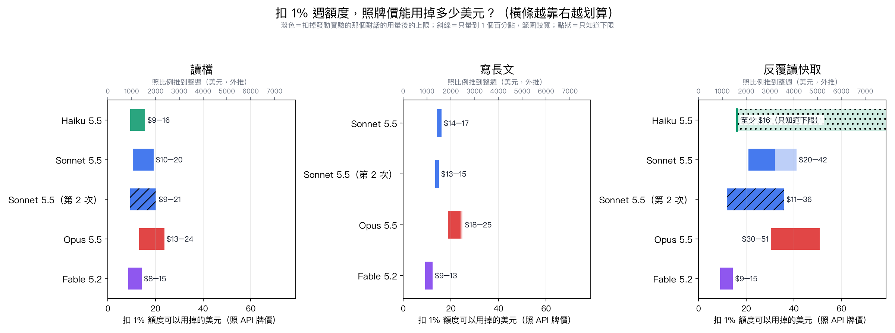

# Claude 訂閱扣額度，有沒有照 API 的價差？

Claude 的 API 牌價是公開的：Fable 大約是 Opus 的 2 倍，Opus 是 Sonnet 的 2 倍，最便宜的 Haiku 在短對話只要 Opus 的四十分之一。訂閱方案不跟你算錢，只給一條用百分比扣的額度條，怎麼換算，官方沒有講。

這份實測想回答一個問題：**訂閱在扣百分比的時候，有沒有照這個價差？** 這次量的都是上下文很長的工作，在這個長度，Haiku 的牌價是 Opus 的八分之一，不是四十分之一（見結論第 4 點）。

做法：拿一個全新、用量 0% 的訂閱帳號，用的是每月 200 美元的方案（介面顯示為 Ultra，即原本的 Max 20x），讓四個模型各做同樣的固定工作，量「額度條每掉 1%，照 API 牌價等於多少美元」。

這個庫放的是研究附件那一類的東西：**實驗設計、實驗數據、分析程式、結論**。你可以用這裡的數據重算每一個數字，也可以拿同一套設計去量自己的帳號。

> 個人實測，不是官方資料，與 Anthropic 無關。只量了一個帳號、一個方案、同一個週額度週期：量測時間是 2026-11-17 15:50 到 2026-11-18 01:45（台灣時間，UTC+8），約 10 小時，量到週額度的 51%。計量規則隨時可能改。文中的「牌價」是 API 定價乘上 token 數，不是實際付款。

**English summary.** An independent, reproducible measurement of how a Claude subscription's weekly usage meter (integer percent) relates to API list prices. One fresh account on the USD 200 per month plan (shown as Ultra in the interface, formerly Max 20x), four models (Haiku 5.5, Sonnet 5.5, Opus 5.5, Fable 5.2), three fixed workloads, measured from 2026-11-17 15:50 to 2026-11-18 01:45 (UTC+8), about 10 hours inside a single weekly quota window, up to 51% of the weekly limit. Finding: the meter does not follow the API price ratios. Per 1% of weekly quota, no other model clearly beat Opus; Sonnet (half the list price) buys less list-price usage than Opus on long-form writing; Fable buys roughly 37% to 65% of what Opus buys on long-form writing and less than half on repeated cache reads (on file ingestion the ranges overlap). Experiment design, prompts, data and analysis code are included. Verified on macOS only. Documentation is in Traditional Chinese. Not affiliated with Anthropic.

## 結論

基準只有一個：**扣 1% 的週額度，換到多少美元的牌價。** 數字越大，代表那個模型在訂閱裡越划算。額度條只顯示整數，所以每個結果都是一段範圍，不是一個點。

| 工作 | Haiku 5.5 | Sonnet 5.5 | Opus 5.5 | Fable 5.2 |
|---|---|---|---|---|
| 讀檔 | 9.4 ~ 15.7 | 9.4 ~ 20.4 | 13.2 ~ 23.7 | 8.5 ~ 14.2 |
| 寫長文 | 未測 | 13.5 ~ 16.1 | 18.8 ~ 25.0 | 9.2 ~ 12.3 |
| 反覆讀同一份資料 | 16.1 以上 | 11.9 ~ 41.1 | 30.4 ~ 50.8 | 9.1 ~ 14.4 |

表的讀法：

- Sonnet 每種工作跑了兩次，表中取兩次裡最小的下限與最大的上限；每一次各自的範圍見 [RESULTS.md](RESULTS.md)。
- Fable 欄讀的是「每週 Fable」分項讀數（那一條的 1 點等於總額度的 0.5%），表中已換算成「每 1% 總額度」。
- Opus 寫長文的 25.0、Sonnet 反覆讀的 41.1，是扣掉主持對話（發動並記錄這次實驗的那個 Claude Code 對話，用的是 Fable 5.2）同時段用量後的上限；那兩格沒扣時的上限是 24.0 與 32.1，RESULTS.md 兩個都列。
- 下圖把 Sonnet 兩次分開畫，標示的範圍往外取到整數美元。



1. **沒有照價差扣。** 如果所有模型都照同一個折扣換算，在預設的時間容許值（讀數與帳本對時容許的誤差）下，算出來的用量和額度條的讀數差約 8 個百分點（8.02）；把時間容許值放到很寬，也還差約 7.9。讓每個模型各有一個折扣，差距縮小到 0.72 個百分點（時間容許值很寬時是 0.54）。這第二個差距小，和資料本來就對不上的約 0.2 個百分點（預設時間容許值下，最寬鬆的假設也還差這麼多）相去不遠，所以只能說「不太對得上」，不算明確推翻。更直接的證據是第 5 點：同一個模型做不同的工作，每 1% 換到的牌價範圍互不重疊（Opus 反覆讀同一份資料 30.4 到 50.8，寫長文 18.8 到 25.0）。各假設的數字見 RESULTS.md 的 fit 與「放寬時間誤差」兩節。
2. **半價的 Sonnet，在訂閱裡不是半價。** 寫長文時，同樣扣 1%，Sonnet 換到的牌價是 Opus 的 0.54 到 0.86 倍。換成例子：一份寫作工作交給 Opus 扣了 2%，照牌價交給 Sonnet 應該只扣 1%，量到的是大約 1.2% 到 1.8%。另外兩種工作，讀數的刻度太粗，分不出誰比較省。
3. **最貴的 Fable，寫長文與反覆讀時，同樣的額度只換到一半左右，甚至更少。** 同樣扣 1%，Fable 換到的牌價，寫長文是 Opus 的 0.37 到 0.65 倍，反覆讀同一份資料是 0.18 到 0.47 倍；讀檔時兩者的範圍重疊（0.36 到 1.07 倍），分不出來。反過來說，同一份工作交給 Fable，扣的額度是交給 Opus 的 1.8 到 6.4 倍（讀檔每個子任務 1.8 到 5.4 倍；寫長文同樣的 token 3.0 到 5.4 倍；反覆讀每一次呼叫 2.4 到 6.4 倍），而牌價只差 2 倍（反覆讀同一份資料時，兩者牌價只差大約一成）。Fable 另外有自己的上限：最多只能用掉總額度的一半。
4. **Haiku 有省，但沒有省到四十倍。** 同一份讀檔工作，Opus 扣的額度是 Haiku 的 3.2 到 9.7 倍。這份工作一次送進去的資料超過 10 萬 token，在這個長度 Haiku 的牌價是 Opus 的八分之一，不是四十分之一，所以量到的和牌價大致對得上。短對話是不是真的四十倍，這次沒有量。另外要注意兩點：帳本記的 Haiku 推理強度是 low（要求的是 xhigh），其他三個模型是 xhigh；Haiku 這一格 150 個子任務有 31 個讀得明顯比設計少，所以比較用的是子任務用量的中位數。
5. **反覆讀同一份資料（快取讀取）時，每 1% 換到的牌價最多。** Opus 最清楚：每 1% 換到 30.4 到 50.8 美元，明顯高於它自己做另外兩種工作；反推的結果是 Opus 重讀一個快取 token 扣的額度，約是第一次寫入快取（5 分鐘）一個 token 的 1/34 到 1/160（牌價是 1/25），這個範圍是用不同工作型態的格子反推的，不是單獨量到的，算法見 `bin/cache_weight_bounds.py`。Sonnet 只有第一輪看到同樣的現象（20.9 以上，對寫長文的 16.1 以下），第二輪的範圍太寬，分不出來。Fable 看不出這個差別，三種工作都在 8.5 到 14.4。實務上的讀法是：一件事留在同一個對話裡做，比一再開新對話、重新載入檔案省額度；這是從不同工作型態的比較推論出來的，不是拿同一件真實工作直接比較。

上面的倍數由 `bin/compare_models.py` 從 `data/cells.csv` 與 `prices.json` 算出，執行 `.venv/bin/python bin/compare_models.py` 可以重現。快取讀取的換算範圍由 `bin/cache_weight_bounds.py` 從 `data/cells.csv` 與 `prices.json` 反推，執行 `.venv/bin/python bin/cache_weight_bounds.py` 可以重現。

還不能說的事與這份資料的限制，見 [docs/KNOWN_LIMITATIONS.md](docs/KNOWN_LIMITATIONS.md)。完整的說明文章見 [docs/ARTICLE_zh.md](docs/ARTICLE_zh.md)。

## 實驗設計

- **兩條互相獨立的資料線，事後用時間對起來。**
  - 額度讀數：每週用量百分比，和訂閱介面「用量」頁顯示的是同一組數字。這份資料的讀數是自動取樣程式（`quota_lab.py sample`）大約每兩分鐘讀一次。讀它不呼叫模型、不花額度。
  - 用量帳本：Claude Code 每呼叫一次模型，會在本機的對話紀錄檔留下 token 數。把每一筆乘上官方 API 牌價（[prices.json](prices.json)），就是這一筆照牌價值多少美元。
- **固定的工作。** 餵給模型的是程式用固定種子產生的無意義英文單字（一份約 40 萬 token），四個模型拿到的內容與份量完全一樣。
- **三種工作**，差別在成本主要落在哪一類 token：讀檔（快取寫入）、寫長文（輸出）、反覆讀同一份資料（快取讀取）。
- **每一格以一個模型做一種工作為主**，前後各記一筆事件，這樣才知道那幾個百分點主要是誰扣的。有幾格同時段混進了別的用量：主持對話自己的用量，以及 Fable 讀檔那一格進行時，另有不屬於量測的工作在跑（主要是 Sonnet 與 Opus，約 7 美元）。分析把它們分開：非 Fable 的格，主模型要占格內非 Fable 用量的 95% 以上才算受控，主持對話同時段的用量另外扣除、修正上限；Fable 的格改看只計 Fable 的「每週 Fable」分項讀數。Sonnet 下午跑一輪、晚上把順序倒過來再跑一輪，當作重複。
- **範圍而不是單一數字。** 讀數是整數，所以每一格算的是「至少多少、至多多少」，再用線性規劃檢驗「照牌價比例扣」這類假設會不會和讀數矛盾。

每個細節都寫在這三份文件：

| 文件 | 內容 |
|---|---|
| [PROTOCOL.md](PROTOCOL.md) | 完整流程：起跑前的準備、怎麼記讀數、怎麼跑每一格、判讀規則、可能出錯的地方與對策 |
| [docs/PROMPTS.md](docs/PROMPTS.md) | 交給模型的提示詞原文，以及每一格實驗的參數 |
| [docs/DATA_DICTIONARY.md](docs/DATA_DICTIONARY.md) | 每個資料檔、每個欄位的意思 |

## 實驗數據

| 檔案 | 內容 |
|---|---|
| `data/samples.jsonl` | 額度讀數，一行一次嘗試（426 次，318 次成功；失敗的多半是被用量端點限速） |
| `data/ledger.jsonl` | 用量帳本，一行一次模型呼叫（模型、各類 token 數、照牌價的美元數） |
| `data/events.jsonl` | 實驗事件：每一格的開始與結束時間 |
| `data/cells.csv` | 每一格實驗的結果：扣了幾個百分點、對應多少美元、範圍的上下限 |
| `data/jumps.csv` | 讀數每一次跳動的時間，與當下帳本的累計美元 |
| `data/fit/` | 線性規劃檢驗的結果 |
| [RESULTS.md](RESULTS.md) | 由程式從上面的資料產生的結果總表 |
| `charts/` | 由程式產生的圖 |

資料只涵蓋受控實驗這一段（週額度 0% 到 51%）。為了公開，帳本拿掉了訊息代號、請求代號與來源檔名，對話與子任務代號換成流水號；官方用量回應的原始內容沒有放進來，只留讀數。這些處理不影響分析結果。帳本來自量測那台機器上的對話紀錄檔，別人無法從原始紀錄重建，只能拿來重算。

## 怎麼用

### 一、用這裡的數據重算（不需要訂閱帳號）

先用 `git clone` 把整個庫抓下來（一鍵檢查要用到 git，只下載壓縮檔不行），並進到抓下來的資料夾：這一節與下一節的指令都在庫的根目錄執行。需要 Python 3.10 以上：macOS 內建的 `/usr/bin/python3` 版本太舊，請另外安裝，並讓 `python3` 指到新版（流程腳本裡叫的也是 `python3`）。

本庫只在 macOS 上驗證過，其他系統未驗證：圖表的中文字型只找 macOS 內建字型；量自己的帳號時，產生測試檔要讀 macOS 的系統單字表 `/usr/share/dict/words`。

```bash
python3 -m venv .venv
.venv/bin/pip install -r requirements.txt
.venv/bin/python bin/analyze.py summary
.venv/bin/python bin/analyze.py cells
.venv/bin/python bin/analyze.py fit --lead 60 --slack 0.1
.venv/bin/python bin/analyze.py charts
```

`summary` 會重新產生 `RESULTS.md`，內容應該和庫裡的一模一樣。驗證時用的套件版本鎖在 [requirements-lock.txt](requirements-lock.txt)，要逐位元組重現就改用它安裝。要一次檢查全部（編譯、測試、重算後把文字結果逐位元組比對）：

```bash
PY=.venv/bin/python bash bin/check_repo.sh
```

全部通過會印出 `CHECK_REPO_OK`。沒有安裝 Node 18 以上或 gitleaks 時，那幾項會略過，印出 `CHECK_REPO_PARTIAL` 並以結束碼 4 結束：這表示有檢查沒跑，不表示資料有錯。

### 二、量自己的帳號

完整步驟在 [PROTOCOL.md](PROTOCOL.md)。下面所有指令都要用「一」建好的虛擬環境（`.venv/bin/python`），請先做完「一」的前兩行（建環境、裝套件）；乾淨機器上的 `python3` 沒有分析用的套件（numpy 等）。大致是：

1. 把資料夾指到你自己的位置（這個庫的 `data/` 是已發布的資料，程式會拒絕寫進去）：

   ```bash
   export QUOTA_LAB_DATA="$PWD/runs/my-run"
   export QUOTA_LAB_T0=2026-12-01T00:00:00Z   # 改成你開始實驗前的時間（UTC）
   mkdir -p "$QUOTA_LAB_DATA"
   ```

2. 產生固定的測試檔，並確認和這裡用的是同一份：

   ```bash
   .venv/bin/python bin/make_corpus.py
   .venv/bin/python bin/make_corpus.py --verify
   ```

   單字表版本不同時 `--verify` 會對不上，處理方式見 [PROTOCOL.md](PROTOCOL.md) 第 3 節。

3. 記讀數。最簡單的方式是打開訂閱介面的用量頁，自己抄：

   ```bash
   .venv/bin/python bin/quota_lab.py manual --all 7 --fable 3
   ```

4. 在 Claude Code（本研究用 2.1.325 版）的對話裡，用它的 Workflow 工具執行 `bin/quota_cell_workflow.js`，跑一格實驗（一個模型、一種工作）。可直接貼的參數（含必填的 `root`，即本庫的絕對路徑）見 [docs/PROMPTS.md](docs/PROMPTS.md) 的「可直接貼的參數」，流程細節見 PROTOCOL.md 第 5 節。手抄讀數的人不要帶 `settle`，跑完自己等讀數穩定再抄一次。
5. 建帳本、出結果（結果寫在 `$QUOTA_LAB_DATA/RESULTS.md`，不會蓋掉庫裡那份）：

   ```bash
   .venv/bin/python bin/quota_lab.py ledger
   .venv/bin/python bin/analyze.py summary
   ```

注意三件事：

- 實驗會真的用掉你的訂閱額度。
- 建帳本只讀你本機的 Claude Code 對話紀錄檔，分析只讀資料夾裡的檔案，都不碰登入憑證；手抄讀數也不需要憑證。自動取樣（`quota_lab.py sample`）不一樣：它呼叫你自己準備的讀取模組，用你自己的 Claude 登入去查用量端點（和「用量」頁是同一組數字，但不是公開文件記載的介面），登入出問題時還可能執行 `claude auth status` 讓登入續期。這個庫不附這個模組；要不要用、合不合你的服務條款，請自己判斷。
- 你的方案、你的那一週，規則可能和這裡不同。量出來不一樣，比一樣更有價值，歡迎開 issue 附上你的 `RESULTS.md`。

## 限制

- 一個帳號、一個方案、同一個週額度週期（實際量測約 10 小時），量到週額度的 51%。整週、整月的美元數都只能外推，不是量到的。
- 讀數只有整數，每一格只夾到 1 到 3.5 個百分點，所以範圍寬。
- 量的都是資料很多的工作（一次 20 萬到 45 萬 token 左右）。短的一問一答沒有量。
- Haiku 只量到一半：「反覆讀」只有下限，寫長文沒有測。
- 只量扣多少額度，沒有比較哪個模型做得比較好。

完整清單見 [docs/KNOWN_LIMITATIONS.md](docs/KNOWN_LIMITATIONS.md)。

## 別人做過的類似實測

這個實驗是獨立設計、獨立完成的。做完之後才去查，發現英文、日文、中文、韓文等語言的網路上都有人量過類似的事。他們怎麼量、量到什麼、和這裡的結果哪裡相似哪裡不同，連同完整出處整理在 [docs/RELATED_WORK.md](docs/RELATED_WORK.md)。

## 授權

程式採 MIT 授權；資料、圖表與文件採 CC BY 4.0。見 [LICENSE](LICENSE)。引用時請註明本庫的名稱與網址。
